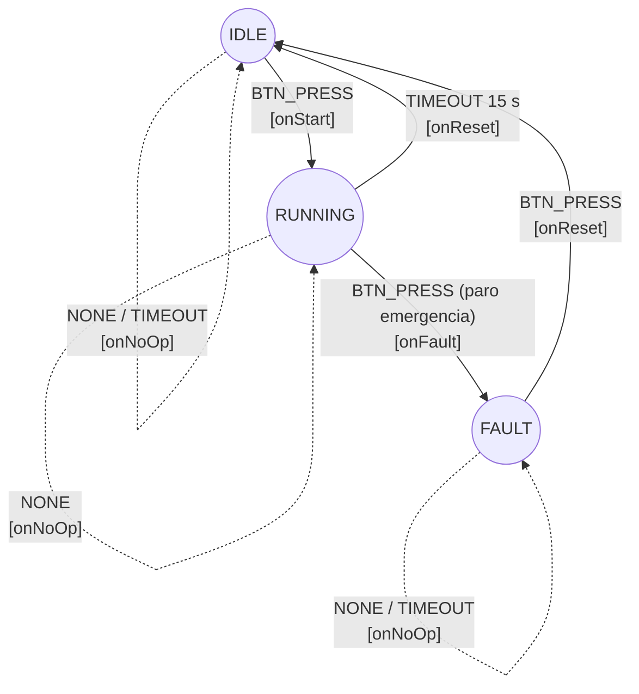

# Firmware Controlador de Banda Transportadora

## Diagrama de la FSM

## Fase 1: Entorno y Control de Versiones

Se creó un proyecto de PlatformIO para la placa `esp32dev` con el framework `arduino`, y se versionó con Git en la rama `main`.

* **Velocidad del monitor serial:** $115200\text{ baudios}$.
* **Frecuencia de CPU:** $160\text{ MHz}$ (`board_build.f_cpu`), por lo que un ciclo dura $T = \frac{1}{160 \times 10^{6}} = 6{,}25\text{ ns}$ y $4{,}000{,}000\text{ ciclos} = 25\text{ ms}$.
* **`.gitignore`:** excluye `.pio/` (compilados y dependencias) y archivos locales de VS Code.
* **Flujo:** un commit descriptivo y un `push` al completar cada fase.

## Fase 2: Capa de Abstracción de Hardware (HAL)

Se implementó la HAL en `hal_motor.h` y `hal_motor.cpp` para aislar el control del actuador de la lógica de la FSM.

### Configuración del Periférico LEDC (PWM por Hardware)
Para el puente H dual L9110S de la IdeaBoard se configuró el periférico `ledc` del ESP32:
* **Frecuencia:** $1000\text{ Hz}$ para evitar ruido audible en el bobinado del motor.
* **Resolución:** $10\text{ bits}$, es decir $2^{10} = 1024$ niveles, de `0` (0 %) a `1023` (100 %).
* **Canales:** `LEDC_TIMER_0` compartido; canal `0` en `IO12` (A) y canal `1` en `IO14` (B). El timer se configura **antes** que los canales.

### Funciones de Control del Actuador
* `motorPWM(uint32_t cicloTrabajo)`: avance; PWM en el canal A y canal B en `0`. Satura la entrada en `1023`.
* `motorBrake()`: **frenado dinámico**; ambos canales al 100 % (`1023`), lo que cortocircuita los terminales del motor y disipa la energía cinética.
* `motorStop()`: **coast**; ambos canales en `0`, el motor se detiene por fricción e inercia.

## Fase 3: ISR y Depuración por Ciclos

El paro de emergencia se atiende con una interrupción externa en `IO33` (`INPUT_PULLUP`, flanco `FALLING`).

### Restricciones del Silicio y Concurrencia
1. **`IRAM_ATTR`:** `botonISR()` se almacena en IRAM para evitar *Guru Meditation Error* por fallos de caché cuando la caché de la Flash SPI se deshabilita (escrituras NVS, OTA).
2. **`volatile`:** `pulsacionesPendientes`, `pulsacionesTotal` e `isrUltimoCiclo` son `volatile`, para que el compilador no las mantenga en registros de CPU (optimización `-O2`) y se lea siempre la RAM.
3. **Spinlock:** una ISR no tiene TCB y no puede bloquearse, por lo que no se usan mutex ni semáforos. Se usa `portMUX_TYPE` con `portENTER_CRITICAL_ISR()` / `portEXIT_CRITICAL_ISR()` en la ISR y `portENTER_CRITICAL()` / `portEXIT_CRITICAL()` en `loop()`. `pulsacionesTotal` es `uint64_t` y su lectura se protege para evitar *torn reads*.

### Depuración (Debouncing) No Bloqueante
La ISR lee `XTHAL_GET_CCOUNT()` y descarta cualquier flanco si no pasaron al menos $4{,}000{,}000$ ciclos ($25\text{ ms}$ a $160\text{ MHz}$) desde el último válido. La resta de enteros de 32 bits sin signo calcula $\Delta = (c_1 - c_0) \bmod 2^{32}$, correcta aunque ocurra *rollover* (cada $\frac{2^{32}}{160 \times 10^{6}} \approx 26{,}84\text{ s}$).

## Fase 4: FSM Orientada a Eventos

* **Estados:** `IDLE`, `RUNNING`, `FAULT`. **Eventos:** `NONE`, `BTN_PRESS`, `TIMEOUT` (ambos `enum class`).
* **Matriz:** `TransitionFSM[Estado][Evento]` es un arreglo bidimensional `constexpr`-style de estructuras `{nextState, action}`. El despacho es una lectura de matriz más una llamada indirecta: $O(1)$, sin `if-else` ni `switch` anidados.
* **Bucle principal:** `loop()` consulta `isButtonPressed()` (con spinlock), genera el evento y llama a `fsmDispatch()`. El `TIMEOUT` se obtiene comparando `millis()` con la marca de entrada al estado; **no hay `delay()`**.

| Estado \ Evento | NONE | BTN_PRESS | TIMEOUT |
|---|---|---|---|
| IDLE | onNoOp | onStart → RUNNING | onNoOp |
| RUNNING | onNoOp | onFault → FAULT | onReset → IDLE |
| FAULT | onNoOp | onReset → IDLE | onNoOp |
